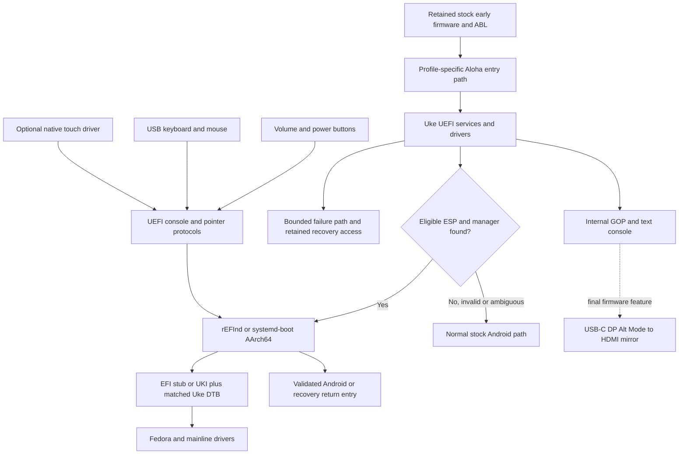

# Uke Project Aloha implementation plan

Date: 5 October 2026. Status: researched plan; no Uke firmware implementation,
build, emulation or physical acceptance was performed for this document.

Implementation has subsequently started in the [initial core record](IMPLEMENTATION-STATUS.md).
It adds portable ESP/input code, host fixtures, an AArch64 EFI diagnostic and
QEMU user-mode checks; the plan's physical exit gates remain open.

The first product is a Uke AArch64 UEFI platform that can run **rEFInd and
systemd-boot**, start Fedora/Linux, and reliably return to stock Android and
recovery. Volume and power buttons and USB keyboard/mouse support are required.
Touch is a conditional extension. **USB-C-to-HDMI preboot screen mirroring is
the final firmware-feature milestone.** Windows ARM64 follows that as the last
multiboot expansion and is outside the first delivery.

The normal boot policy is **discover an eligible ESP and launch its admitted
manager; otherwise boot ordinary Android**. Storage planning must accommodate
Android userdata, Linux, the shared ESP and a future Windows area within the
capacity currently allocated to userdata, subject to measured Uke geometry and
the recovery migration gate. No sizes or physical offsets are assumed here.

This plan expands workspace roadmap steps 045–056 and the existing
[architecture](ARCHITECTURE.md). It does not mark those steps complete.

The owner's installation deliverable is an [Android boot-patching ZIP](BOOT-INSTALLER-CONTRACT.md)
with real Uke firmware and an ARM64 selector, following the Nabu method with
Uke-specific inputs. A standalone EFI diagnostic is an intermediate artifact.

## 1. Evidence and starting position

| Finding | Evidence and limit | Planning consequence |
|---|---|---|
| No Uke platform in the inspected upstream Aloha tree | Live `main` resolved to `7c81a0c77fbf77bc28a305e1e9d075f53648f93b`; full top-level recursive tree and the pinned CrDK tree were inspected. No Uke/SM7675 platform or matching silicon directory was found. This does not exhaust every fork or nested dependency. [A1] | Budget for a silicon/platform port, not a device-name change. |
| Existing archive differs from the live review | Local donor and source catalog remain at `8d37e2bfab2f9d959ac0b3d68434e8be4866bf55`. The archive ledger still records `archive_complete=false`, separate submodule archives pending and file-level license review pending. | Retain the locked control revision; compare the new candidate before explicitly adopting it. |
| Aloha has ten top-level gitlinks | Both revisions have ten; six of their pins differ. Exact live pins are recorded in [the evidence inventory](../manifests/port-plan-evidence-2026-10-05.json). | Recursive dependency, binary and host-tool closure is a deliverable of its own. |
| Uke stock evidence is available | The 3 October stock record is POCO Pad X1 8 GB / 512 GB, Global `OS2.0.205.0.VOZMIXM`, SM7675, locked/green boot state. Its raw GPT and live DT contents were inaccessible. [L1] | Refresh the exact unit/profile and lock state before a physical trial. OS3 package analysis is a separate input. |
| Direct Uke early-display work exists | ztsubaki `32cad9ccd383ff4b37d8a5e7f88a8bfdcc07307e` reports inherited ABL simplefb, with incomplete flashed-image/slot/log association. [D1] | Useful handoff research; remeasure framebuffer ownership and geometry for our profile. |
| Same-SoC source is useful but incomplete | Palawan/Lamma and OEM Uke DT references exist; the reviewed Palawan UFS PHY compatible lacks a matching driver entry at its recorded pin. [L2] | Linux source is an IP reference, not an EFI UFS driver or proof that storage initializes. |
| Boot-manager input support differs | Inspected systemd-boot source handles volume scan codes and power-as-suspend; rEFInd documents mouse and touch modes, their mutual exclusion and submenu limits. [B1–B3] | Qualify two manager profiles and separate keyboard, mouse and touch acceptance. |

GitHub repository searches for `uefi sm7675` and `uefi uke` returned only this
project's repositories; `edk2 sm8635` returned none. These are bounded discovery
results, not proof that no unpublished port exists. Generic `ukefi` means Unified
Kernel EFI tooling and is not a Uke silicon implementation.

The component's preparation manifest is not the archive ledger: an existing
reference clone does not establish an imported development tree or image.
The current device status remains authoritative for physical results. [L3]

## 2. Intended architecture



Aloha owns early execution, memory ownership, EFI services, GOP, console input,
preboot USB/storage, OS loading and reset/return integration. The kernel owns
Linux device drivers, DRM/GPU, power management, audio, sensors and networking.
Recovery owns inventory, backup, reviewed installation and restoration. Fedora
owns boot entries, kernel/initramfs/DT packaging and update policy.

Use the existing EDK II C/assembly conventions. New native companion utilities
use C++; host orchestration uses Bash. Keep source archives unchanged under
`referances/`, and development under `src/`, `patches/` and configuration.

**UEFI does not require converting Linux to ACPI.** The initial Linux contract
uses a real, kernel-matched Uke DTB through EFI. ACPI/Windows table work is a
separate future activity. The arm64 kernel selects one hardware-description
method at boot; an Aloha DSDT or placeholder DTB is insufficient. [K1–K3]

## 3. Resolve entry and return before peripheral work

The first platform contract must establish how Aloha is entered. Stock firmware
containing UEFI code or partitions named `uefi_a/b` does not establish an
accessible EFI application launcher, live Boot Services or a safe replacement
partition. ABL may already have exited its own EFI environment before entering
a kernel-style payload.

Compare these candidates in a written decision record:

1. A secondary payload delivered through an exact-profile Android boot-image
   path, preserving stock early firmware. Establish image header, load regions,
   DT/DTBO selection, AVB constraints and actual entry register/state contract.
2. A genuine EFI chainload path only if source and runtime evidence establish
   it. Do not assume inherited handles, protocols or HOBs survive another path.
3. Recovery-mediated loading only if its low-level backend is proven. A menu
   option, kexec binary or generic fastboot command is not such proof.

Prefer a temporary RAM trial when the actual bootloader supports it. If it does
not, record that limitation and require a separately reviewed, reversible
installation procedure; this plan does not authorize unlocking or flashing.
Bootloader unlocking may reset user data under the Android contract. [A2]

The contract records firmware hashes, available RAM banks, reserved regions,
protected firmware volumes, load/stack/heap/log/DT/initrd placement, exception
level, MMU/cache/GIC/timer state, PSCI/reset interfaces, DMA/SMMU ownership and
SMEM/remote-processor carveouts. Preserve secure monitor, hypervisor, XBL, ABL,
security/DDR firmware and unit calibration. Determine allowed memory from Uke
evidence; do not transplant Nabu, Sheng, Muyu or QRD addresses.

Android return must bypass re-entering Aloha indefinitely. Investigate the
matched boot-mode/reset mechanism, original slot and recovery entry; preserve
Virtual A/B and update state. A/B is not independent userdata isolation. Do not
offer an Android entry until its backend is proven. The missing-ESP case must
reach ordinary Android through this same backend without requiring a file on
the absent ESP, persistent EFI variables, or an endless reset back into Aloha.
If entry from ABL prevents such a route, resolve the dispatcher design before
admitting a boot image. Do not assume that returning from a secondary firmware
payload resumes ABL. Test return early and after
each driver stage, rather than postponing it until the menu is polished.

### ESP discovery and Android fallback

**12 October implementation correction:** the [current policy](BOOT-POLICY.md)
requires the GPT name `ESP` as well as the type GUID and validated identity.
It tries `EFI/BOOT/BOOTAA64.EFI`, then a unique installed ARM64 EFI application.
Project configuration is optional legacy compatibility, not a prerequisite for
rEFInd or systemd-boot discovery. This supersedes the initial configuration
requirement below; physical Uke storage/firmware/return acceptance remains open.

The firmware performs read-only discovery on the admitted internal UFS devices.
Validate media identity, logical-block size, capacity, GPT headers/array checksums
and entry bounds before interpreting partitions. Select candidates by the EFI
System Partition type GUID (`C12A7328-F81F-11D2-BA4B-00A0C93EC93B`), then validate
the filesystem and platform policy. A label such as `esp`, a FAT signature alone,
or a stock partition named `uefi` is insufficient.

Prefer a provisioned partition GUID recorded in the reviewed boot profile. An
initial unbound discovery may admit exactly one eligible ESP containing a valid
Uke configuration and manager. Multiple candidates without an unambiguous
selection return to Android; never pick the first enumerated disk. External USB
ESP boot is an explicit later selection and must not hijack ordinary startup.

Read a bounded configuration containing the schema version, firmware/profile
identity, selected manager and allowed relative path. The installation plan will
define exact paths for rEFInd, systemd-boot and the optional AArch64 fallback
loader. Check file bounds, path traversal, architecture and integrity policy
before LoadImage/StartImage. A new signature policy must retain recovery access;
stock Android AVB and EFI Secure Boot are distinct mechanisms.

| Discovery or dispatch result | Required action |
|---|---|
| No ESP, inaccessible UFS, timeout or no eligible partition | Bounded diagnostic, then ordinary Android |
| Invalid GPT/FAT, ambiguous ESP selection or wrong profile | No repair or write; return to Android |
| ESP exists but configuration/manager is missing, invalid or wrong architecture | Return to Android |
| Admitted manager is available | Launch the selected manager and expose Android/recovery entries |
| Manager returns a load/start error | Return to Android through the proven backend |
| Manager hangs or resets unexpectedly | Hardware/reset escape and qualified watchdog policy; do not claim that a synchronous load-error handler covers hangs |

Discovery never formats, repairs GPT, changes slots, creates an ESP or rewrites
defaults. The missing-ESP return backend is part of the firmware entry design,
not an application stored only on the ESP. Test every row with disposable host
fixtures and repeat the accepted cases on the actual profile before release.
Fallback guarantees the intended dispatch decision; damaged media or a broken
stock chain can still prevent Android from starting and require a separate
recovery result.

### Planned userdata-derived multiboot layout

The conceptual allocation is:

```text
Retained Uke boot/security/recovery/dynamic-system partitions
Former userdata allocation, repartitioned only through reviewed recovery:
  Android userdata | shared ESP | Linux root/data | future Windows allocation
```

This is an allocation model, not a prescribed order or GPT map. The measured
stock record maps userdata to one of six disk names but does not establish its
physical start/end sectors or durable LU identity. Recover exact geometry and
both GPT copies first. Preserve stock early firmware, `super`, encryption-related
metadata and calibration partitions. Do not confuse shrinking userdata with
resizing Android logical partitions inside `super`.

Android userdata remains shared by its A/B slots. The recorded stock filesystem
is F2FS with encryption; do not assume an online or in-place shrink is supported,
that a raw encrypted copy is a portable restore, or that changing GPT alone
resizes the filesystem. Recovery must decide between a demonstrably supported
offline resize and an explicit backup/recreate/restore or reset procedure, with
the data-preservation limitation stated before execution. Validate Android boot,
encryption, recovery and OTA behavior against the new layout.

The installer owns partition creation and ESP population after its write gate;
Aloha only discovers and consumes the resulting layout. Partition sizes depend
on actual capacity, Android requirements, Linux usage and the chosen future
Windows budget. Windows may need additional support partitions under its later
installation contract. Keep those requirements and their capacity reservation
in the recovery plan; do not install Windows or invent its final layout now.
All operating systems share the ESP without overwriting another loader's files.

## 4. Firmware services and boot-manager qualification

Provide coherent system/boot-service tables, image loading, device paths, memory
maps, events/timers, GOP, Simple Text Output, aggregated console input, Block I/O
and Simple File System for approved media. Start with an embedded or RAM-backed
diagnostic EFI application; storage is not required merely to prove EFI entry.
Run each manager separately before adding optional manager-to-manager chaining.

| Capability | rEFInd AArch64 profile | systemd-boot AArch64 profile |
|---|---|---|
| Internal display | GOP; verified resolution, stride, pixel layout and readable scaling | GOP-backed EFI text console with usable rows/columns |
| Volume/power | Start with a text-menu compatibility profile; qualify graphical main menu and submenus separately | Source already accepts volume up/down and `SCAN_SUSPEND`; standard arrows/Enter remain a common compatibility path [B1] |
| USB keyboard | Console aggregation; arrows, Enter, Escape and menu access | Same; verify Simple Text Input Ex behavior and menu timeout |
| USB mouse | Simple Pointer protocol and a separately tested `enable_mouse` configuration [B2] | The inspected menu consumes keys. Firmware mouse enumeration does not promise native mouse navigation. |
| Touch | Absolute Pointer and a separately tested `enable_touch` configuration [B2] | Optional explicit gesture-to-key compatibility layer; no claim of native touch hit-testing. |
| Linux entries | Explicit EFI-stub/UKI entries and matched DT/initramfs | Type #1 entries or Type #2 UKIs on an accessible ESP/XBOOTLDR [B3] |
| Android/recovery | Approved return EFI entry | The same approved return EFI entry |
| Persistent preference | Qualify variable or file writes separately | Qualify variable writes, boot counting and seed-file behavior separately |

Both managers must boot the same known diagnostic payload and then the same
accepted Linux payload. Use exact AArch64 artifacts and provenance; x86 EFI
binaries are invalid inputs. Pin the actual Fedora package or release build
selected for integration. The inspected systemd main commit is research
evidence, not a decision to ship unreleased systemd.

During storage-read-only trials, reject writes below the filesystem layer,
expose honest read-only media and test write-error handling. Audit automatic
seed, boot-count, configuration and variable writes. Start with explicit entries,
a visible timeout and unavailable persistence reported accurately. Do not rely
on BootNext, BootOrder, `bootctl install`, or an installer until the backend and
its write effects have been qualified.

### Button and USB implementation

Implement a Uke button DXE that samples the proven PMIC/TLMM key source and
publishes Simple Text Input and Simple Text Input Ex through the console
aggregator. Publishing an isolated private key protocol is insufficient.

- Volume up/down selects previous/next; short power selects with Enter.
- Match manager layout: a vertical text list can use Up/Down, while rEFInd's
  graphical rows may require Left/Right and a separately tested back/submenu
  action. Do not infer full graphical navigation from a successful arrow event.
- Define debounce, delayed repeat, release-before-select, stuck-key recovery and
  bounded queues. A key held during power-on must not immediately launch an OS.
- Preserve the hardware long-power reset escape and stock entry combinations.
  Any back chord is scoped to the running menu and tested for conflicts.
- Aggregate physical keys and USB keyboard input without duplicates or starvation.

USB work includes the Type-C data role, VBUS/power ownership, controller/PHY,
clocks, resets, DMA mappings, xHCI host operation, hub enumeration and standard
USB keyboard/mouse DXEs. A working Android ADB gadget does not prove this host
path. Begin with wired USB 2.0 HID; then test direct adapters, composite devices,
the JH925 hub, both connector orientations and hotplug. USB mass storage is a
separate extension. A keyboard and mouse must coexist.

For systemd-boot, native keys are the acceptance baseline. If mouse-operated
navigation is desired there, add a clearly documented optional wheel-to-Up/Down
and click-to-Enter adapter, enabled only for that manager. This is key emulation,
not a graphical cursor. Do not inject both pointer and key events into rEFInd.

### Touch feasibility and implementation

The stock record identifies an NVT SPI binding and `nt36532_touch`; it does not
establish a reusable EFI driver. Inspect the exact sensor/controller variant,
SPI/GENI bus, rails, reset/IRQ, initialization, report format and any volatile
firmware requirement. The Android THP/HAL/uinput path cannot execute in UEFI.

First prove bounded native reads and a single contact, then publish Absolute
Pointer with orientation, coordinate scaling and release behavior. Do not run
calibration commands or persist vendor firmware as a shortcut. Volatile firmware
loading, if required, needs provenance and an explicit initialization contract.
On failure, keep physical keys and USB usable and leave the device in a state
that Android/Linux can initialize.

rEFInd's reviewed documentation makes `enable_mouse` and `enable_touch`
mutually exclusive and describes submenu-selection limits. First deliver
separate mouse and touch profiles. Simultaneous operation requires a separately
tested solution: for example an explicit input-profile switch, a reviewed
upstream change, or a bounded pointer adapter. Exposing both protocols alone
does not establish that the manager consumes both. [B2]

## 5. Work packages and acceptance gates

The order below is the intended critical path. Source analysis and host fixtures
can proceed while device prerequisites are being resolved. No hardware milestone
is complete on the strength of compilation or QEMU.

| ID / priority | Dependencies | Deliverable | Required exit evidence |
|---|---|---|---|
| M0 / P0 | Existing stock records | Profile and recovery readiness; current lock/slot/update state; private backup and return materials | H0 record; physical access, exact-profile recovery entry and stock restoration prerequisites reviewed |
| M1 / P0 | None | Aloha candidate comparison; recursive pins, licenses, toolchain and upstream host-tool lock | U0 archive/dependency review; offline restore for admitted sources; a reference build remains a foreign-target build |
| M2 / P0 | M1; stock/profile evidence | Entry/return decision and memory/firmware contract | No invented addresses; overlap/overflow/profile-negative fixtures; unresolved entry or protected-memory constraints stop H1 |
| M3 / P0 | M2; M0 before device execution | Minimal Uke SEC/PrePi/DXE, bounded log, timer, exception/reset path and EFI probe | U0 build plus H1 probe entry, observable result, timeout escape and Android/recovery return |
| M4 / P0 | M3 | Inherited internal framebuffer GOP, text console and physical key protocols | H1 readable full-panel output, all basic selections and 100 press/release events without duplicate power activation |
| M5 / P0 | M4 | rEFInd and systemd-boot launched from a disposable RAM/FAT test medium; early EFI-stub Linux diagnostic | Each manager navigates and starts the identical test payload; Linux RAM diagnostic records actual EFI/DT handoff; Android return remains usable |
| M6 / P0 | M3–M5 | UFS read-only access, exact LU/GPT identity, ESP discovery and approved manager loading; Linux storage takeover | U0/U1 malformed/absent/duplicate ESP fixtures; H1 bounded reads, no write admission and normal Android boot when ESP/manager is unavailable |
| M7 / P0 | M4–M6 | USB host, hub, keyboard and mouse | H1 direct and hub HID, both orientations, 20 reconnect cycles, unplug-at-selection and continued button operation; actual mouse selection in rEFInd |
| M8 / P0 | M5–M7; recovery write/restore gate | Reviewed userdata migration to Android + ESP + Linux with a future Windows capacity plan; Fedora entries, fallback and recovery one-shot interface | H2 exact geometry/backup/migration records; Android data/encryption/OTA checks; missing/corrupt payload, replay and power-interruption cases; durable one-shot consumption |
| M9 / P1 | M7–M8 | Native touch feasibility result, then optional pointer driver and manager profiles | Four corners/center, all admitted orientations, 100 tap/release pairs, bounds/timeout errors, mouse/touch profile behavior and OS reinitialization |
| M10 / P0 release gate | M8; M9 only for claimed touch support | Reproducible candidate, manifest/SBOM/license/payload audit and per-profile support statement | At least 10 cold and 10 warm cycles per admitted boot-manager/profile; Android/recovery return, disconnect, recovery and bounded thermal observations |
| M11 / P2 final | M10; actual dock identity; DP research | USB-C-to-HDMI **preboot mirror**, with internal display retained | One monitor first, conservative 1080p60 candidate mode, correct aspect ratio, continued HID, unplug fallback and Linux/Android transition |
| W0 / future, last | M11 resolved; separate feasibility review | Windows ARM64 research and eventual multiboot integration | Separate ACPI/driver/security/storage and physical acceptance; an ESP or working Linux boot is insufficient |

M5's RAM Linux diagnostic is an early subtest; it does not close the workspace's
storage-dependent step 052. M6 must separately prove the kernel can take over
UFS: EFI reading a file does not establish Linux PHY/driver support.
M8 maps to steps 053–056 and recovery URE-09. Installation, repartitioning or
ESP persistence waits for the existing H2 recovery/write gate.

## 6. Linux handoff and boot requests

Use the EFI stub's entry contract for PE/COFF loading; do not conflate it with
the raw arm64 Image entry ABI. Validate the final Linux transition against
the kernel documentation, including DT/initrd placement and DMA quiescence. [K1–K2]

Check real DT magic, bounds, compatible/profile identity, selected overlays and
reserved-memory coverage. Retain required stock carveouts and record framebuffer
ownership. Validate GetMemoryMap/ExitBootServices sequencing and map-key changes,
with no unsafe allocation or boot-service use after handoff. Memory attributes,
SMMU/clock transitions, EFI runtime availability and kernel peripheral takeover
are separate cases. A successful splash does not prove any of them.

The initial Linux diagnostic may use an embedded initramfs and conservative
inherited display. Long-term `ignore_unused` debug parameters are not a completed
clock/power implementation. General Fedora ISO boot is not a substitute for a
kernel/DT/initramfs matched to Uke.

Use the versioned one-shot contract in [ARCHITECTURE.md](ARCHITECTURE.md): exact
target/entry and firmware profile, expected components, request identity and
consumption state. Validate and durably consume before dispatch. A read-only
firmware phase cannot implement durable consumption by pretending a write
succeeded; keep that feature disabled until M8. Unknown/replayed requests,
missing entries, unavailable persistence and interrupted acknowledgment must
reach an explicit fallback without repeatedly launching the same failed entry.

## 7. Final display milestone: USB-C to HDMI

The researched topology is USB-C **DisplayPort Alt Mode** followed by the dock's
DP-to-HDMI conversion. Ordinary USB HID support does not provide video output.
The OEM DP capability and JH925 advertising are source evidence; our specimen's
revision, link and firmware remain untested. Use the existing RC1001/JH925
laboratory and test records. [L4]

First inventory the Type-C/PD owner and available firmware interfaces, mux/retimer,
DP PHY, clocks, AUX/HPD/EDID, link training and display controller resources.
Determine whether a profile-matched inherited DP configuration is possible or
native firmware initialization is required. If neither is supportable, record
M11 as blocked; Linux DRM external output may still be a separate achievable
result, but it does not satisfy preboot mirroring.

Start with one HDMI monitor, dock attached at boot, SDR and a conservative mode.
Keep the internal screen primary, with aspect-correct scaling or letterboxing.
Multiple GOP handles do not automatically mirror a boot manager. Audit whether
each manager writes directly through FrameBufferBase or uses GOP Blt, and choose
a shared scanout or copying design that covers the actual drawing path. A Blt
wrapper alone is insufficient when direct framebuffer writes bypass it.

Then test disconnect/reconnect, absent or bad EDID, slow link training, retained
USB keyboard/mouse, power-role changes, charging and OS takeover. External-screen
failure must not delay the internal menu indefinitely. Touch coordinates remain
bound to the primary logical display. MST, dual HDMI, high refresh, HDR and HDMI
audio are later independent features, not conditions for the first mirror.

## 8. Repository deliverables and first execution batch

Proposed paths below are future implementation outputs, not existing code:

- `docs/PLATFORM-CONTRACT.md`: exact profile, memory, entry/return and resource ownership.
- `docs/BOOT-MANAGER-COMPATIBILITY.md`: pinned manager artifacts, ESP discovery/fallback cases and measured service/input matrix.
- `manifests/build-inputs.lock.json`: admitted upstream, recursive gitlinks, binary hashes/licenses and host-tool closure.
- `profiles/`: reviewed profile facts and partition-selection policy with no unit identifiers or calibration values; unit-specific GUID binding remains in private installation state.
- `src/`: minimal silicon/board implementation and diagnostic EFI payload; a platform package name such as `CliffsPkg` remains provisional until upstream layout review.
- `patches/`: focused upstream-compatible changes, with unchanged archives retained separately.
- `tests/`: memory/profile, EFI handoff, input-state and read-only media fixtures; physical records remain separate.
- `reports/`: reviewed summaries with exact build/firmware/test IDs; raw logs stay private.

First batch: (1) compare the two Aloha pins and admit a baseline, (2) audit all
recursive dependencies and binary provenance, (3) write the profile and entry/
return contracts, (4) define the smallest RAM-backed diagnostic and input
fixtures, and (5) select pinned AArch64 rEFInd/systemd-boot test artifacts.
Only then estimate the first physical build. Entry restrictions, protected
memory and firmware-driver dependencies are currently too uncertain for a
credible fixed delivery date. Re-estimate after M2, M5 and touch feasibility.

The upstream Mu/Stuart/EDK II build path uses Python. Before running it, document
the exact interpreter/packages, purpose and why reproducing the upstream build
requires them; resolve compatible-version ranges and transitive dependencies
into exact hashes. Invoke approved upstream tooling only in the host development
tree. No project-owned Python tool or Python runtime is introduced on the tablet,
in firmware, recovery, initramfs or delivered Fedora payloads.

## 9. Sources and evidence references

- [A1: Aloha inspected commit](https://github.com/Project-Aloha/mu_aloha_platforms/tree/7c81a0c77fbf77bc28a305e1e9d075f53648f93b), with [exact Git-tree API](https://api.github.com/repos/Project-Aloha/mu_aloha_platforms/git/trees/7c81a0c77fbf77bc28a305e1e9d075f53648f93b?recursive=1). Source snapshots and hashes are listed in the evidence inventory; no donor code was executed.
- [A2: AOSP bootloader locking contract](https://source.android.com/docs/core/architecture/bootloader/locking_unlocking). This is not a current Xiaomi unlock-service eligibility determination.
- [B1: systemd-boot key dispatch](https://github.com/systemd/systemd/blob/b11ba559a6311a2a8ace17aaafe3237d5ff8b158/src/boot/boot.c#L721) and [console input](https://github.com/systemd/systemd/blob/b11ba559a6311a2a8ace17aaafe3237d5ff8b158/src/boot/console.c).
- [B2: rEFInd configuration](https://www.rodsbooks.com/refind/configfile.html) and [AArch64/features](https://www.rodsbooks.com/refind/features.html). Documentation fetched 5 October; qualify the actual selected release before implementation.
- [B3: systemd-boot manual source](https://github.com/systemd/systemd/blob/b11ba559a6311a2a8ace17aaafe3237d5ff8b158/man/systemd-boot.xml) and [loader configuration](https://github.com/systemd/systemd/blob/b11ba559a6311a2a8ace17aaafe3237d5ff8b158/man/loader.conf.xml).
- [K1: arm64 boot protocol](https://docs.kernel.org/arch/arm64/booting.html), [K2: EFI stub](https://docs.kernel.org/admin-guide/efi-stub.html), [K3: arm64 ACPI/DT relationship](https://docs.kernel.org/arch/arm64/arm-acpi.html).
- [D1: Uke simplefb donor record](https://github.com/ztsubaki/uke-linux/blob/32cad9ccd383ff4b37d8a5e7f88a8bfdcc07307e/docs/UKE_SIMPLEFB.md).
- L1: workspace `uke-linux-docs/docs/research/STOCK-ADB-INVENTORY-2026-10-03.md` and `UKE-HARDWARE-STATUS-2026-10-04.md`; dated observations, not a fresh device connection.
- L2: workspace `uke-linux-docs/docs/research/UKE-SM7675-DONOR-HANDOFF-2026-10-05.md` and `UKE-SAME-SOC-LINUX-2026-10-05.md`; exact OEM/Palawan/Uke pins and qualified donor results.
- L3: workspace `uke-linux-docs/docs/testing/TEST-CONTRACT.md`, `DEVICE-STATUS.md` and `manifests/sources.lock.json`.
- L4: workspace `uke-linux-docs/docs/research/ACCESSORY-LAB.md` and `docs/testing/ACCESSORY-TEST-PLAN.md`.

Planning validation covers source-pin consistency, local documentation links,
JSON structure, privacy and whitespace. It establishes no firmware build,
boot-manager execution, USB/touch/HDMI operation or physical return result.
